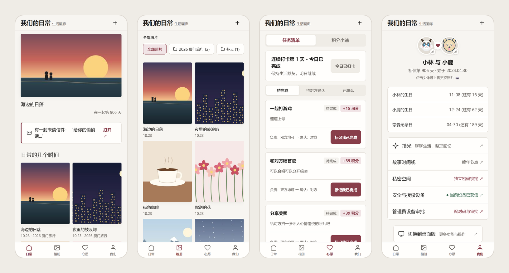
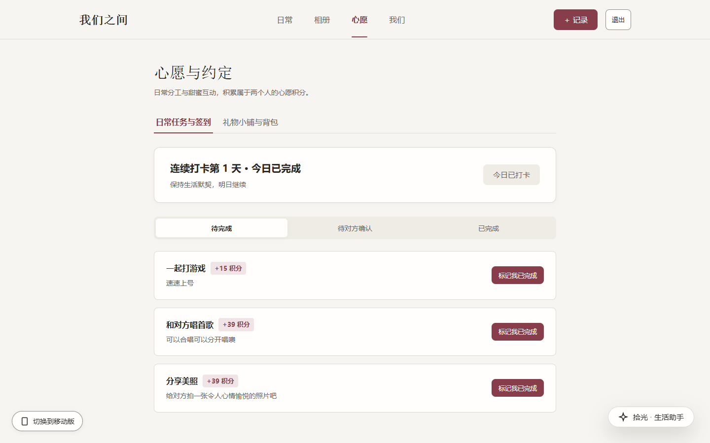
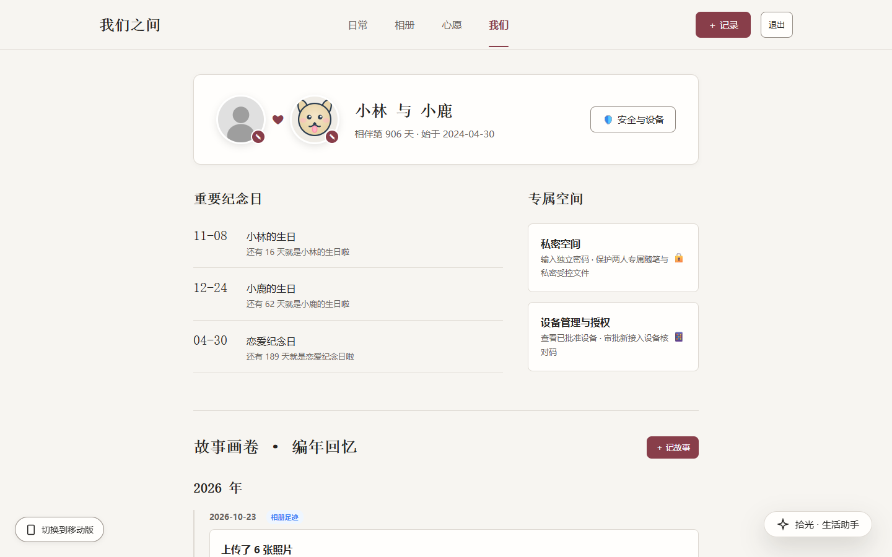
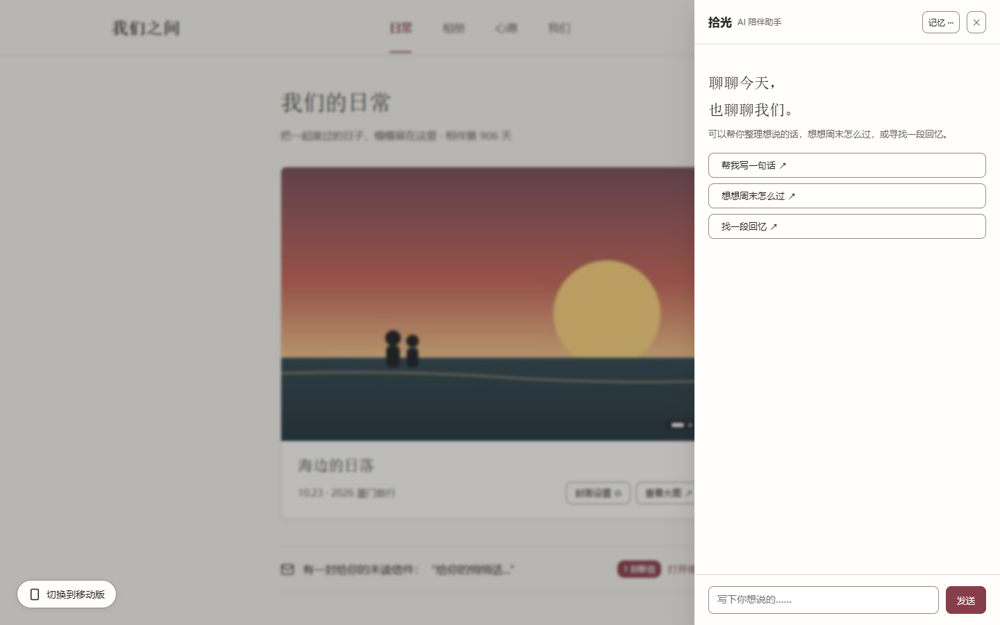
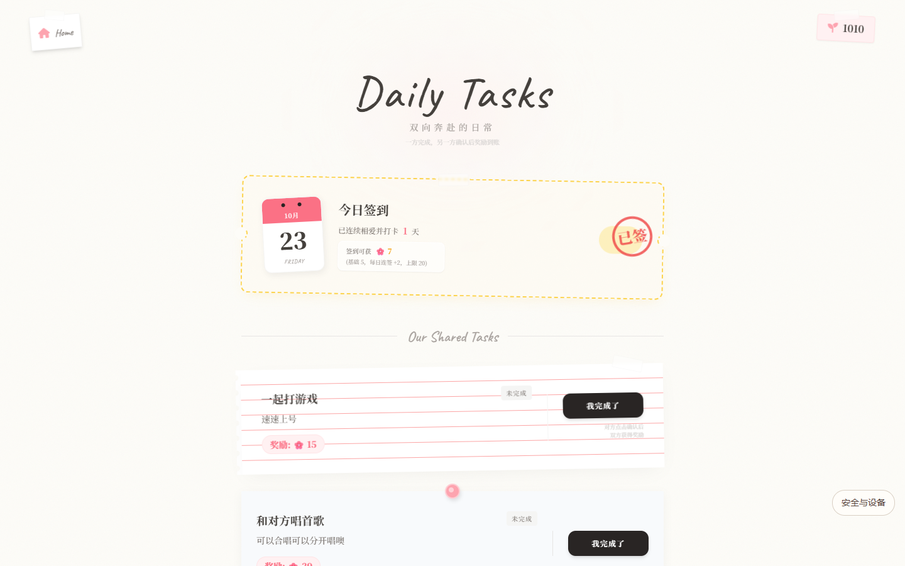
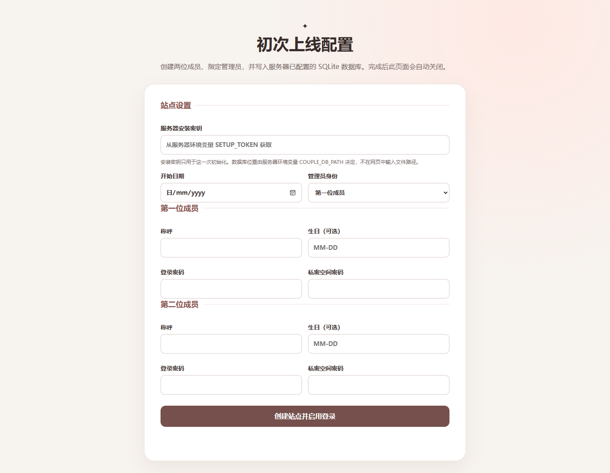

# 我们之间 · 生活画廊

一个供两人使用的私人网站，用来保存照片、日常任务、心愿、悄悄话和共同的故事。服务端使用 Node.js、Fastify 和 SQLite；前端提供移动端与桌面端两套界面。

> 以下截图来自本地演示实例，使用演示称呼和图片。实际站点内容保存在你自己的数据库与上传目录中。




## 功能

| 模块 | 内容 |
| --- | --- |
| 日常 | 相伴天数、封面照片、今日一句和未读消息入口 |
| 相册 | 文件夹、标签、批量上传、缩略图和全屏查看 |
| 心愿与任务 | 每日签到、共同任务、积分与礼物小铺 |
| 我们 | 双方资料、纪念日、故事时间线和设备管理 |
| 悄悄话 | 两人之间的消息 |
| 私密空间 | 独立密码保护的个人笔记与文件 |
| 拾光 | 可选的 AI 生活助手；使用模型功能需要另行配置服务端 |

| 相册 | 心愿与任务 |
| --- | --- |
|  |  |

| 我们 | 拾光 |
| --- | --- |
|  |  |

仓库还保留了通过 Node 服务提供的手账风页面：`/shop.html`、`/task.html` 和 `/story.html`。

| 礼物小铺 | 每日任务 | 故事时间线 |
| --- | --- | --- |
|  |  |  |

## 本地启动与首次配置

需要 Node.js 20 或更新版本。在仓库的 `server/` 目录安装依赖并启动服务。首次使用空数据库时，先设置至少 32 个字符的一次性安装密钥。

macOS / Linux：

```bash
cd server
npm ci
export SETUP_TOKEN="$(openssl rand -hex 32)"
printf '本次安装密钥：%s\n' "$SETUP_TOKEN"
npm start
```

Windows PowerShell：

```powershell
cd server
npm ci
$bytes = New-Object byte[] 32
$rng = [System.Security.Cryptography.RandomNumberGenerator]::Create()
$rng.GetBytes($bytes)
$rng.Dispose()
$env:SETUP_TOKEN = -join ($bytes | ForEach-Object { $_.ToString('x2') })
$env:SETUP_TOKEN  # 记录本次安装密钥
npm start
```

默认地址是 `http://127.0.0.1:19085`，本机 SQLite 数据库默认位于 `server/data/couple.db`。数据库、上传文件和密钥不要提交到 Git。

1. 打开 `http://127.0.0.1:19085/setup`，填写安装密钥、开始日期、两位成员的称呼、各自的登录密码与私密空间密码，并选择管理员。两类密码都要求至少 12 个字符。
2. 初始化完成后访问 `/`。根入口会根据设备宽度和已保存的界面偏好，自动进入 `/h5/index.html` 或 `/desktop/index.html`；在对应界面点击“去登录”，填写自己的称呼、对方称呼和登录密码。
3. 每位成员首次登录的浏览器会自动绑定。后续新浏览器需要管理员核对配对码并批准。
4. 完成初始化后，移除服务端的 `SETUP_TOKEN` 并重启服务，关闭安装入口。



安装页仅对空数据库开放，只会初始化双方账户、管理员身份与开始日期。数据库位置由服务端环境变量 `COUPLE_DB_PATH` 决定，网页不会接收数据库地址或文件路径。已有数据不会被安装页覆盖。全新数据库中的任务和商品需要后续自行配置。

## 部署与数据

生产环境请使用 HTTPS、持久化的 `COUPLE_DB_PATH`、独立的 `SESSION_SECRET` 和服务管理器。Nginx 与 systemd 的示例及安装密钥的管理步骤见[部署与运维说明](deploy/README.md)。`/health/ready` 可用于检查 Node 服务与数据库连接。

仓库中的旧 PHP 实现和旧 JSON 导入工具已经退役。前端仍会请求部分以 `.php` 结尾的 API 地址，但这些路由由 Node 服务处理。不要将旧 JSON 数据直接导入现有 SQLite 数据库。

## 目录结构

| 路径 | 用途 |
| --- | --- |
| `index.html` | 不展示页面的设备自动跳转入口 |
| `h5/`、`desktop/` | 移动端和桌面端界面；桌面端登录页位于 `desktop/login.html` |
| `assets/` | 两套界面共用的静态资源与设备路由脚本 |
| `setup.html` | 首次上线配置页，只通过 `/setup` 对空数据库开放 |
| `server/src/` | Fastify 路由、认证、业务逻辑和 SQLite 存储 |
| `server/tests/` | 服务端与前端行为测试 |
| `deploy/` | Nginx、systemd 示例和运维文档 |

数据库、上传内容、服务端密钥和个人资料应保存在仓库之外，或由 `.gitignore` 排除。不要把数据库放进公开可读的 Web 目录。

## 验证

在 `server/` 目录运行：

```bash
npm run check
npm test
```

GitHub Actions 会在 PR 和 `main` 更新时执行相同的语法检查与测试。
